# The Android app: install, sign in, use

The app backs up the phone's photos and videos to a folder on your Cairn server, browses the server's folders,
and puts the folders you choose into the system's Files picker. It runs on Android 11 and later. It is in no
store yet, so you install its APK yourself.

The screenshots come from an Android 16 phone signed in to a demo server, whose users are alice, bob and carol.
Other phones word the system's screens a little differently.

## What you need

- **The server's address**, such as `https://cairn.example.com`.
- **A token for this phone**, which whoever runs the server makes for your user, one per device:
  `cairn-server token add alice --label android --data <data dir>`. A lost phone's token is then taken back
  alone, by `cairn-server token remove <id>`, with the ID from `cairn-server token list`.
- **The APK**, `Cairn-<version>.apk`. It is not among the release downloads yet: build it from the source
  (`bash scripts/release-android.sh`, see the README's "The Android app"), or get it from whoever runs your
  server. Android installs an update only when the same key signed it, so take every later APK from the same
  place.

## Install

Open the APK on the phone, from a browser's download, the Files app or a chat. From a computer with USB
debugging turned on, `adb install Cairn-<version>.apk` installs it instead.

<table>
<tr><td width="50%">

**1.** A browser asks first whether to keep it: **Download anyway**, then open the download.

</td><td>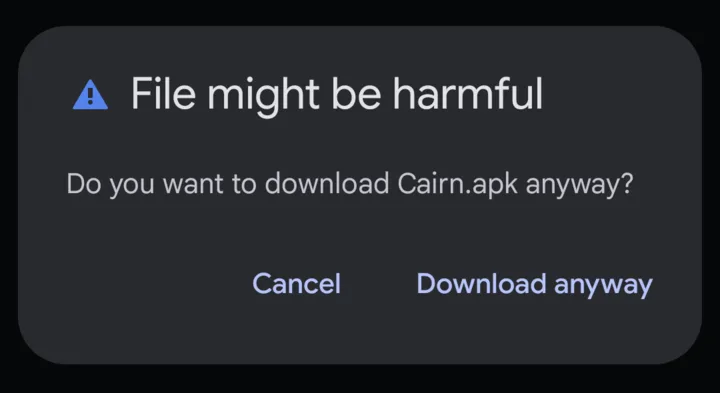</td></tr>
<tr><td>

**2.** Android installs apps only from sources you have allowed. The first time, it says so: tap **Settings**.
If the phone asks which app should open the file, choose **Package installer**.

</td><td>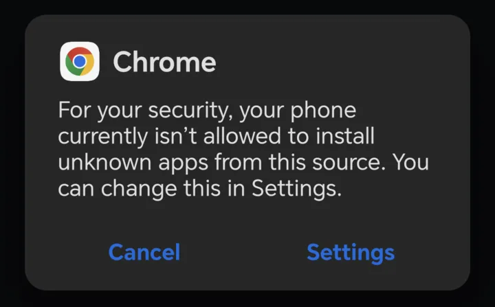</td></tr>
<tr><td>

**3.** Turn on **Allow app installs** for that app. The installer comes back: tap **Install**.

</td><td>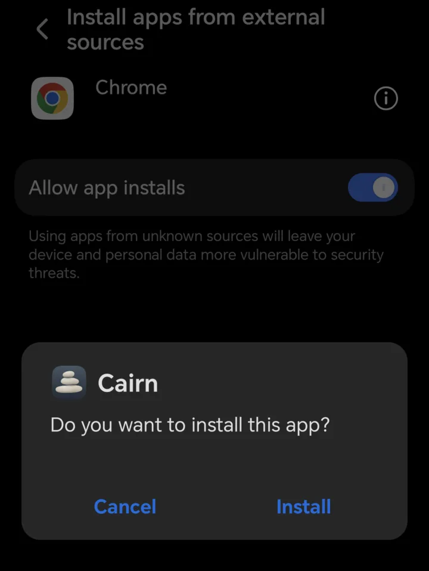</td></tr>
<tr><td>

**4.** Google Play Protect has not seen the app before and recommends a scan. **Scan app** sends the app to
Google first; **Install without scanning** installs it as it is.

</td><td>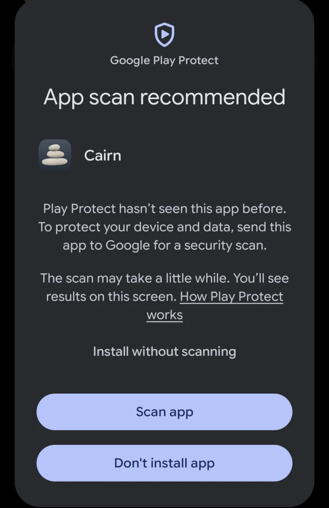</td></tr>
<tr><td>

**5.** **Open** starts the app. Afterwards you can turn **Allow app installs** off again for the browser
(Settings › Apps › Special app access › Install unknown apps); turn it back on for the next update.

</td><td>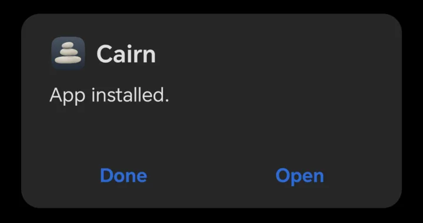</td></tr>
</table>

## Sign in

<table>
<tr><td width="50%">

- **Server:** the address, `https://` and all. A server reached over plain `http://`, on a home network say,
  works only when the address is typed with `http://`.
- **Token:** type it, or copy it and tap **Paste token**.
- **This device's name:** shown in each file's history, and the name of its photos' folder. It starts as the
  phone's model.

Then **Sign in**.

</td><td>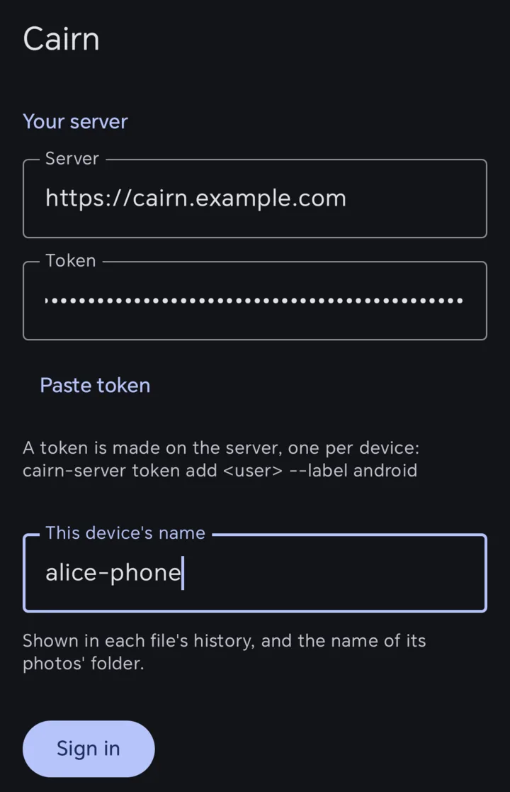</td></tr>
</table>

## Back up photos and videos

After signing in, the **Photos** tab sets up the backup.

<table>
<tr><td width="50%">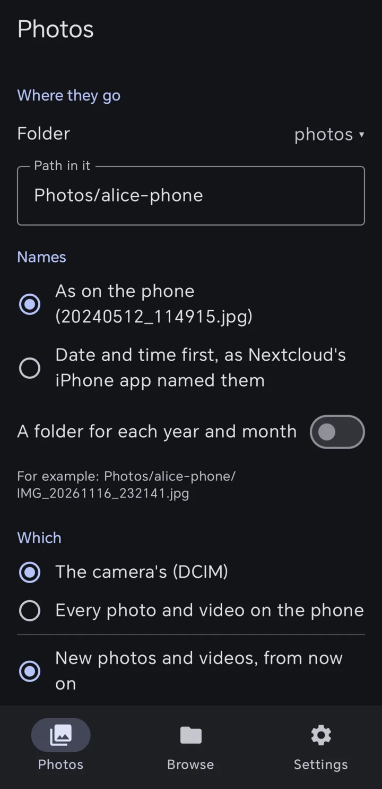</td>
<td>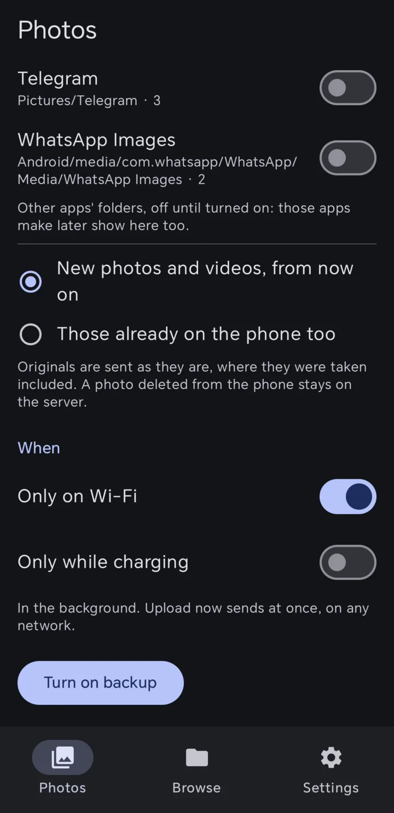</td></tr>
</table>

- **Folder** and **Path in it:** where on the server they go. The folder is one of yours that you can write
  to, and the path starts as `Photos/<this device's name>`.
- **Names:** as the camera named them, `20240512_114915.jpg`, as Nextcloud's Android app kept them; or date
  and time first, as Nextcloud's iPhone app named them, so that a folder it filled goes on as it was.
  Optionally, a folder for each year and month. The line under them shows an example.
- **Which:** a switch for each kind, each with where it is on the phone and how many it holds:
  - **Camera:** on until turned off. It covers DCIM and its folders, but not screenshots.
  - **Screenshots and screen recordings:** off until turned on. This means every folder named Screenshots,
    ScreenRecorder, ScreenRecords or Screen recordings, wherever the phone keeps it.
  - **Other apps' folders:** WhatsApp's, Telegram's, a browser's downloads, and so on. Each folder that holds
    photos or videos has its own switch, off until turned on. A folder an app makes later shows up here,
    off. Until Cairn may see the photos, **Choose other apps' folders** asks for that access.

  Then choose between the new ones from now on, or those already on the phone too.
- **When:** in the background only on Wi-Fi (the default), and only while charging if chosen.

<table>
<tr><td width="50%">

**Turn on backup** asks to send notifications, which Upload now uses, and for access to photos and videos
(unless Choose other apps' folders already asked).
Choose **Allow all**: limited access shows the app only the photos you pick. With it the app may also read
where each photo was taken, which Android takes out of a photo otherwise.

</td><td>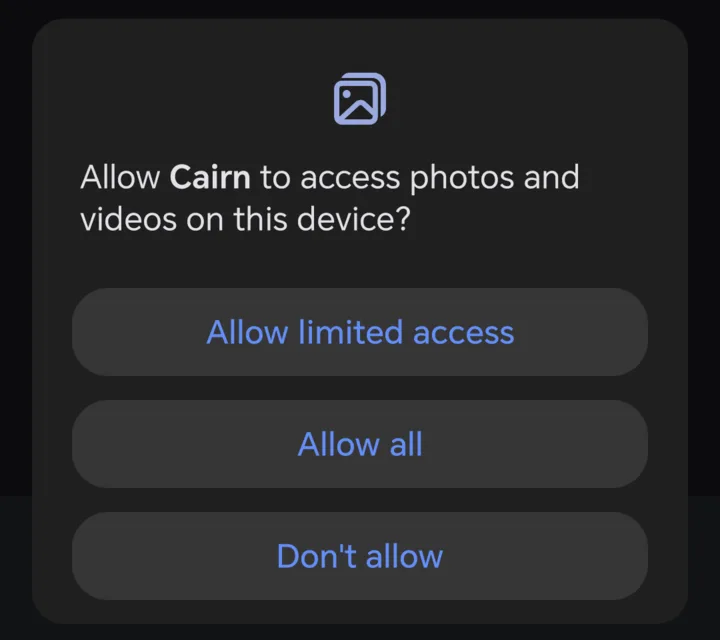</td></tr>
<tr><td>

From then on the tab shows what was sent and what waits. New photos are sent a little after they are taken,
and what waits every hour. **Upload now** sends at once on any network, shown as a notification, and goes on
with the app closed. What could not be sent is listed with the server's reason, and **Retry**. A name the
server already has for other bytes gets `(2)`.

**When** and **Which** can be changed here while backup is on:
- **Switching a folder on** sends what is already in it, or only what was taken since backup was turned on,
  as chosen at the start.
- **Switching a folder off** stops what was waiting from it. What was sent stays on the server.

Originals are sent as they are, where they were taken included. A photo deleted from the phone stays on the
server, and **Turn off backup** keeps what was sent.

</td><td>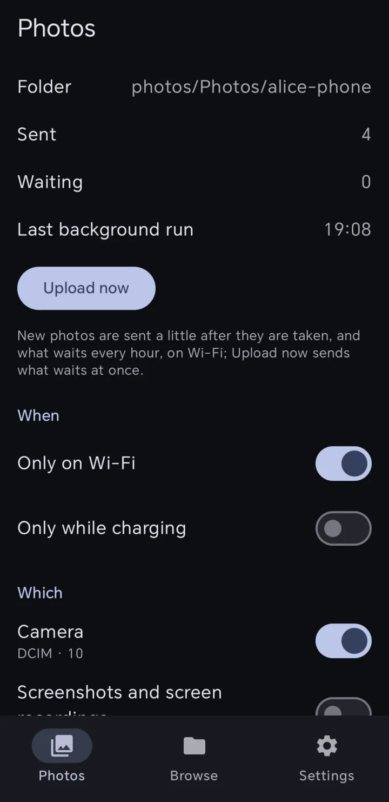</td></tr>
</table>

## Browse the server

The **Browse** tab shows your folders on the server as they are now. A folder you can only read says so.

<table>
<tr><td width="33%">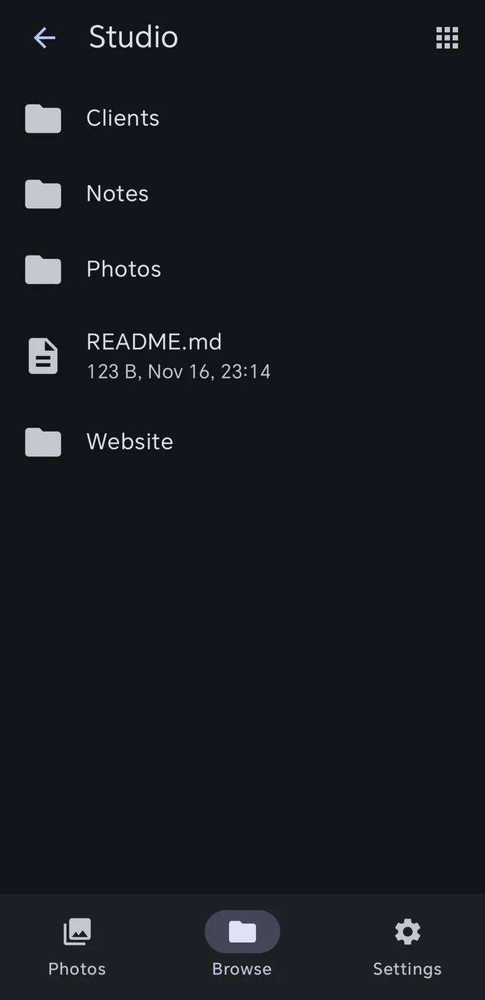</td>
<td width="33%">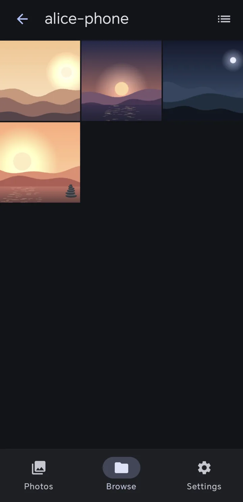</td>
<td>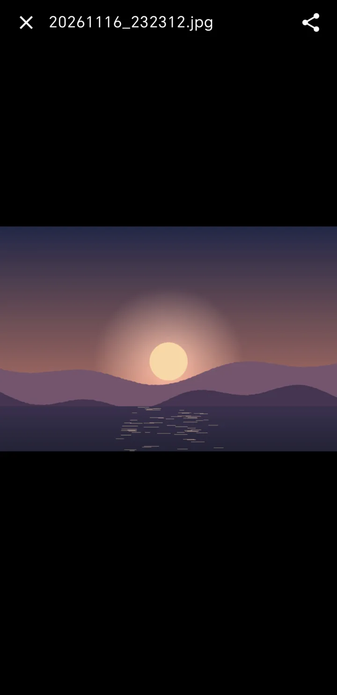</td></tr>
</table>

- The button at the top right switches between a list and a grid of thumbnails.
- A file is downloaded only when it is opened, into a cache that the system empties when it needs room. A
  video streams. **Share** hands the file to another app, and a file the app cannot show opens in one.
- The photos this phone sent take their thumbnails from the phone itself. Others come from the server. On
  mobile data the app reads only the start of a photo, for the small picture a camera puts in it, so a photo
  without one shows a placeholder until the phone is on Wi-Fi.

## In the Files picker

<table>
<tr><td width="50%">

**Settings › In the Files picker** lists your folders. Each one turned on is a place in the system's Files
picker: in the Files app and wherever another app opens or saves a file.

</td><td>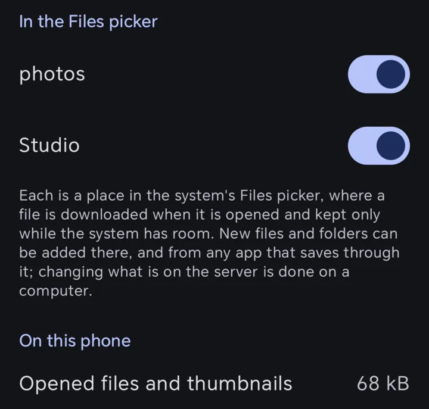</td></tr>
<tr><td>

There it is **Cairn**, with the folder's name under it.

</td><td>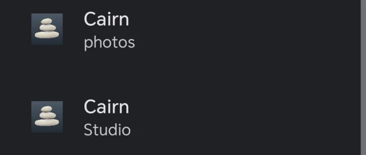</td></tr>
<tr><td>

A file is downloaded when it is opened. New files and folders can be added there, and from any app that saves
through the picker: a new file is kept in the app and queued like a photo, so it is sent whatever happens to the
app or the network. Renaming, moving, deleting and writing over a file are not offered yet; do that on a
computer.

</td><td>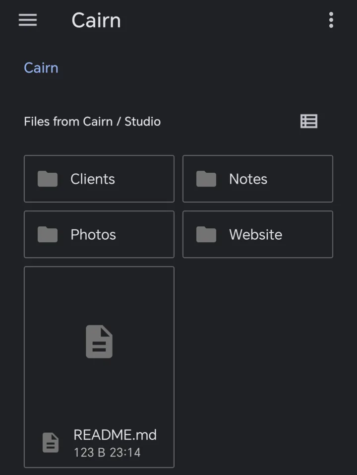</td></tr>
</table>

## Settings

- **Account:** the server, the user, this device's name and the app's version.
- **On this phone:** the space the opened files and thumbnails take, and **Clear**.
- **Sign out:** photos and files not yet sent are not sent; what is on the server stays.

## Updates

The app does not update itself yet. Install a newer APK over it as above: it keeps its settings and what waits
to be sent. Android refuses an APK signed by another key; uninstalling the app to get past that forgets what
was waiting.
